# Smart Freelance and Project Matching Platform

ESPRIT — Ateliers 2, 3 et 4. 12 octobre 2026.

Les sept blocs portent le même nom dans tout le rapport. Le fichier imprimable est `rapport.html`, exporté en `Rapport-Ateliers-2-3-4.pdf`.

| Bloc | Contenu retenu |
| --- | --- |
| Plateforme | Angular, API Gateway :8078, Eureka :8420, Config Server :8888 |
| Identité et comptes | keycloak-auth :8079, user :8090 (userdb) |
| Mise en relation | project :8084, offer :8082, contract :8083, freelancia-job :8097 |
| Profil et réputation | portfolio :8086, review :8085, gamification :8088 |
| Exécution de mission | task :8091, planning :8081, chat :8096, meeting :8101 |
| Support | notification :8098, ticket :8094, subcontracting :8110, vendor :8093 |
| Aide à la décision | aimodel :8095, service ML :8102 |

## 1. Atelier 2 — Exigences fonctionnelles

Hiérarchie : module, sous-module, fonctionnalité.

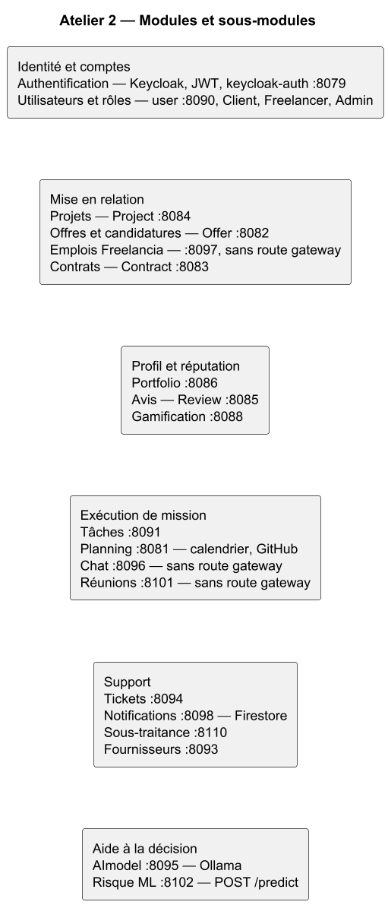

### Identité et comptes

**Authentification**

- Inscrire un utilisateur dans le realm Keycloak `smart-freelance`.
- Connecter un utilisateur et obtenir un jeton JWT, via keycloak-auth (:8079), préfixe `/keycloak-auth`.

**Utilisateurs et rôles**

- Gérer le profil dans le service user (:8090, base userdb).
- Distinguer les rôles Client, Freelancer et Admin.

### Mise en relation

**Projets** (Project :8084, base projectdb)

- Créer, modifier, supprimer et lister un projet (`addProject`, `updateProject`, `deleteProject`, `getAllProjects`).
- Consulter le risque, la satisfaction et le segment client (`getProjectRisk`, `getProjectSatisfaction`, `getClientSegment`).

**Offres et candidatures** (Offer :8082, base gestion_offre_db)

- Créer, publier, rechercher et recommander une offre.
- Postuler à une offre (`applyToOffer`). Cette étape n'envoie pas de notification.
- Accepter une candidature et créer un contrat brouillon (`acceptApplication`).
- Poser une question sur une offre et notifier le freelancer (`addQuestion`).
- Traduire le titre et la description via Google Translate.

**Emplois Freelancia.** Publier et consulter une annonce (FreelanciaJob :8097, base freelancia_job_db). Pas de route gateway.

**Contrats.** Enregistrer le contrat issu d'une candidature acceptée (Contract :8083, base gestion_contract_db).

### Profil et réputation

- Portfolio (:8086) : enregistrer expériences et compétences.
- Avis (:8085) : noter, répondre, et notifier l'autre partie lorsqu'une réponse est créée.
- Gamification (:8088) : suivre niveaux, XP et succès.

### Exécution de mission

- Tâches (:8091) : suivre les tâches et demander une génération au service AImodel.
- Planning (:8081) : publier un avancement, créer un événement Google Calendar, lire branches et commits GitHub.
- Chat (:8096) et réunions (:8101) : échanger et planifier. Aucune route gateway.

### Support

- Tickets (:8094) : ouvrir, lire et rouvrir un ticket.
- Notifications (:8098) : créer une notification (`POST /api/notifications`), stockée dans Firestore.
- Sous-traitance (:8110) : suivre une mission déléguée.
- Fournisseurs (:8093) : tenir le référentiel Vendor.

### Aide à la décision

- AImodel (:8095) : générer un texte ou des tâches, puis appeler Ollama (:11434).
- Service ML (:8102) : estimer le risque d'un projet par `POST /predict`. Seul Project l'appelle.

## 2. Exigences non fonctionnelles

Une ligne **cible** est un objectif. Une ligne **constat** est déjà dans la configuration.

| Exigence | Quantification | Statut |
| --- | --- | --- |
| Temps de réponse des API métier, hors IA | ≤ 2 s au 95e percentile | Cible |
| Timeout global du client HTTP de la passerelle | 4 h | Constat |
| Timeout de la route planning | 30 s | Constat |
| Timeout de la route portfolio | 120 s | Constat |
| Timeout des routes IA | 14 400 000 ms (4 h) | Constat |
| Réplicas gateway et frontend | 2, maxUnavailable = 0 | Constat |
| Corps HTTP à l'ingress | 50 Mo | Constat |
| Codec de la passerelle | 10 Mo | Constat |
| Lecture proxy de l'ingress | 3 600 s | Constat |
| Authentification | OAuth2 / JWT, realm smart-freelance | Constat |
| CORS du profil local | localhost:4200 et 127.0.0.1:4200 | Constat |
| Données | Une base MySQL par service SQL. Notification : Firestore | Constat |
| Accès direct aux services | Refusé sans l'en-tête X-Internal-Gateway | Constat |

## 3. Atelier 3 — Vue building block

### Boîte noire

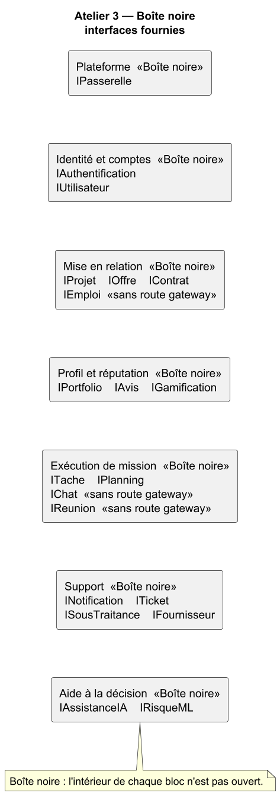

### Dépendances

La passerelle retire le premier segment (`StripPrefix=1`).

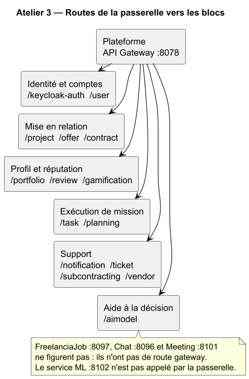

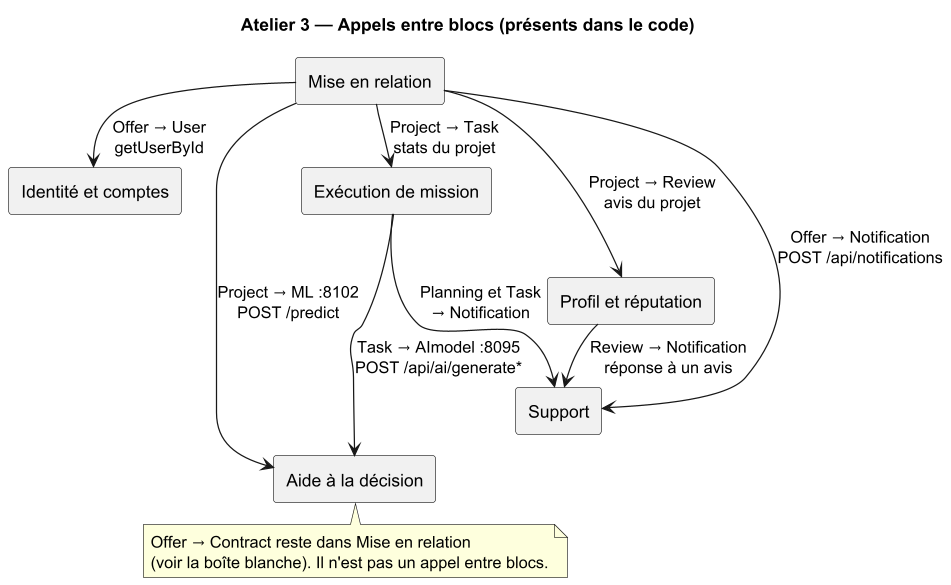

Offer vers Contract reste interne à Mise en relation.

### Boîte blanche de Mise en relation

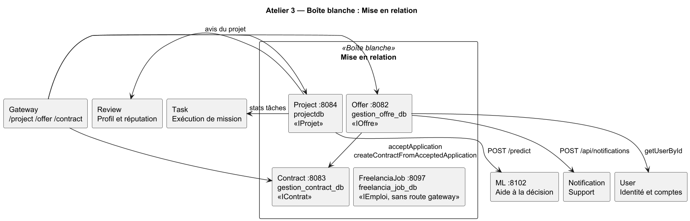

L'acceptation d'une candidature appelle `ContractClient.createContractFromAcceptedApplication`.

### Classes et méthodes

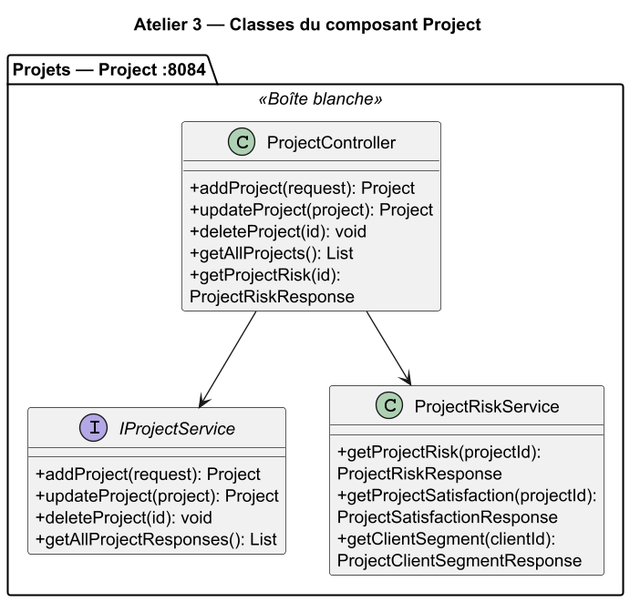

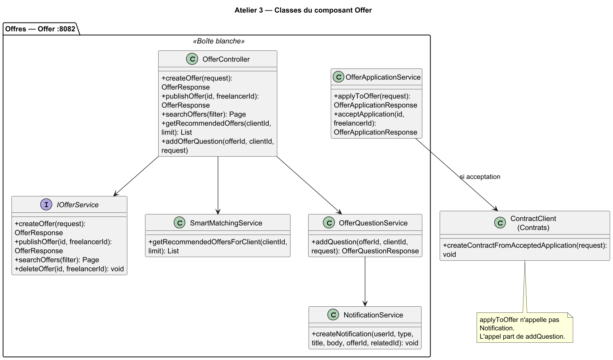

`applyToOffer` n'appelle pas Notification. L'appel part de `addQuestion`.

## 4. Atelier 4

### Contexte

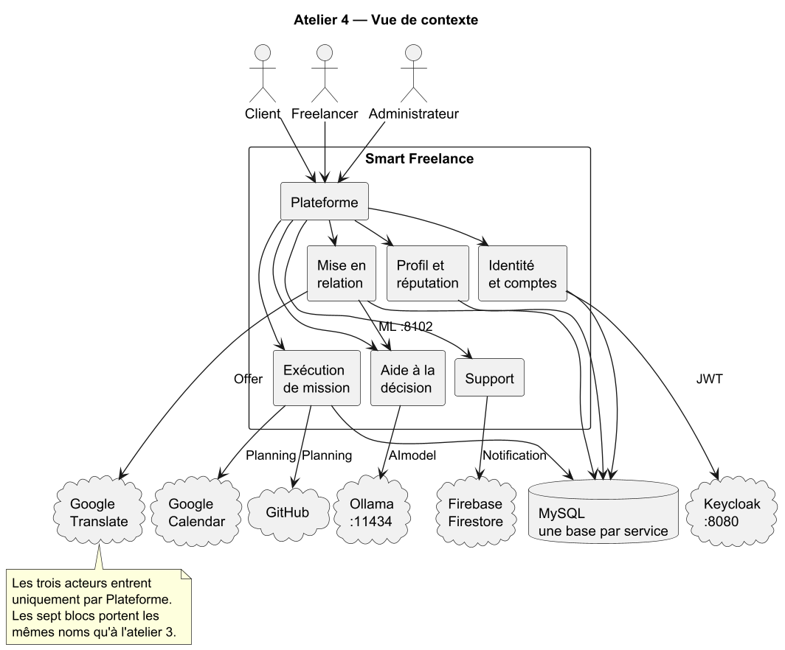

Les acteurs entrent par Plateforme. Keycloak, MySQL, Firebase, Ollama, GitHub, Google Calendar et Google Translate sont hors des sept blocs.

### Déploiement

Namespace Kubernetes `smart-freelance`.

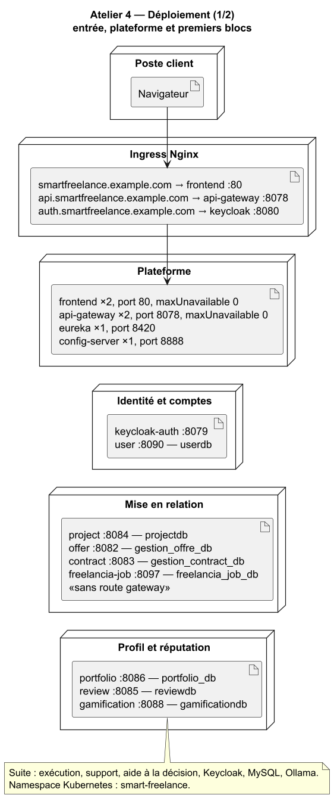

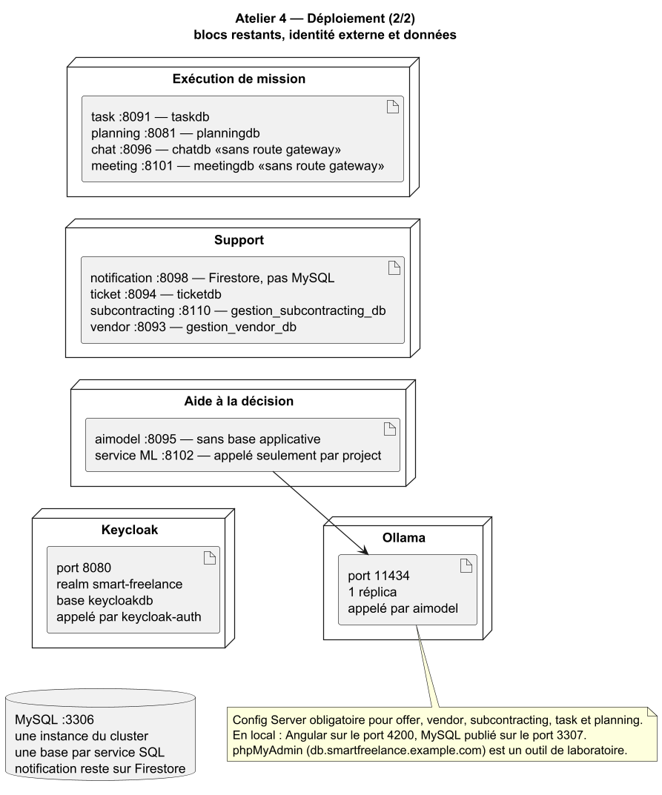

En local : Angular :4200, MySQL publié sur :3307. Dans le cluster, MySQL écoute :3306.

| Service | Port | Préfixe gateway | Donnée |
| --- | --- | --- | --- |
| Eureka | 8420 | — | — |
| Config Server | 8888 | — | obligatoire pour offer, vendor, subcontracting, task, planning |
| API Gateway | 8078 | — | — |
| keycloak-auth | 8079 | /keycloak-auth | Keycloak :8080 |
| user | 8090 | /user | userdb |
| planning | 8081 | /planning | planningdb |
| offer | 8082 | /offer | gestion_offre_db |
| contract | 8083 | /contract | gestion_contract_db |
| project | 8084 | /project | projectdb |
| review | 8085 | /review | reviewdb |
| portfolio | 8086 | /portfolio | portfolio_db |
| gamification | 8088 | /gamification | gamificationdb |
| task | 8091 | /task | taskdb |
| vendor | 8093 | /vendor | gestion_vendor_db |
| ticket | 8094 | /ticket | ticketdb |
| aimodel | 8095 | /aimodel | Ollama, pas de base |
| chat | 8096 | aucune | chatdb |
| freelancia-job | 8097 | aucune | freelancia_job_db |
| notification | 8098 | /notification | Firestore |
| meeting | 8101 | aucune | meetingdb |
| service ML | 8102 | aucune | appelé par project |
| subcontracting | 8110 | /subcontracting | gestion_subcontracting_db |

### Runtime

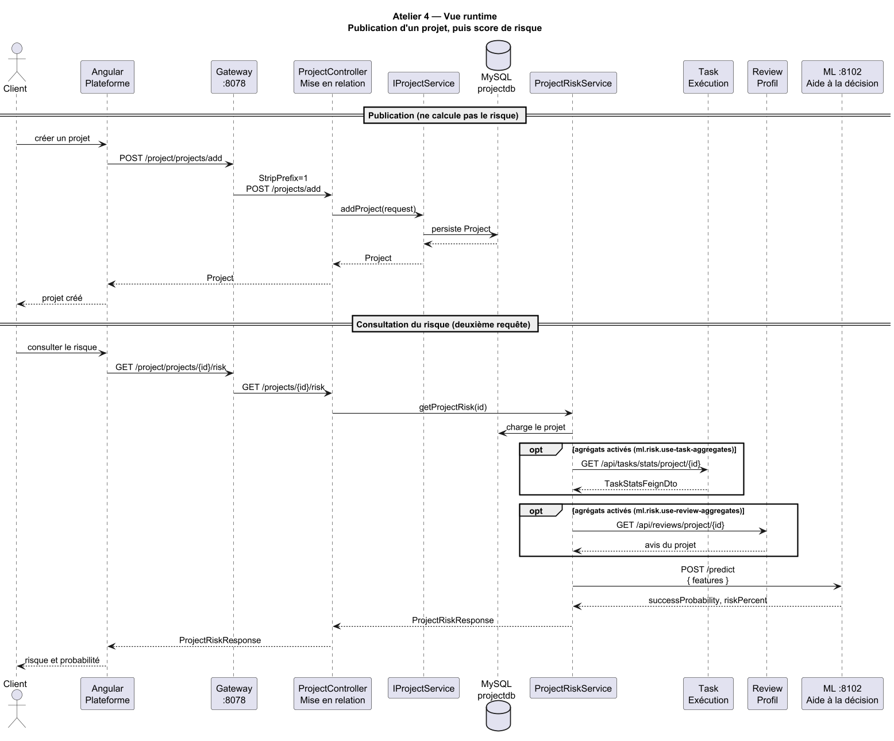

`POST /project/projects/add` ne calcule pas le risque. `GET /project/projects/{id}/risk` charge le projet, interroge Task et Review si les agrégats sont activés, puis envoie `POST /predict` au port 8102.

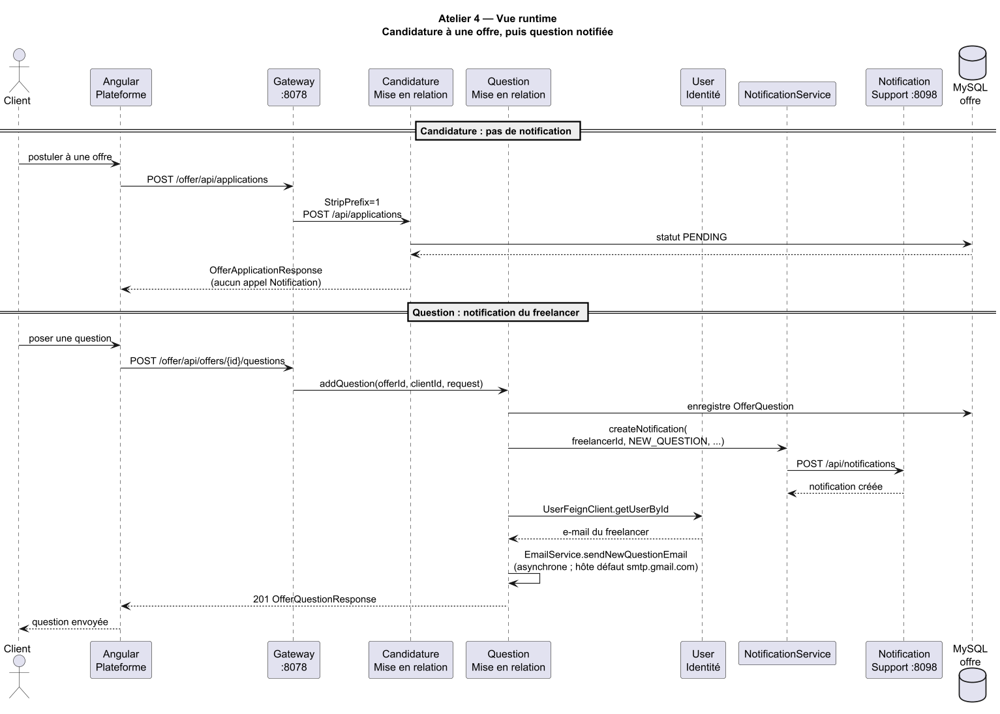

`POST /offer/api/applications` enregistre une candidature PENDING sans notification. `POST /offer/api/offers/{id}/questions` notifie le freelancer (`POST /api/notifications`) et envoie un e-mail SMTP si le mail est activé. L'hôte par défaut d'Offer est `smtp.gmail.com`.
